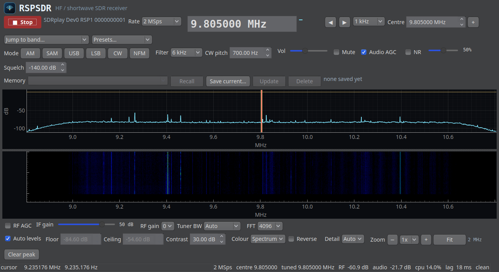

# RSPSDR

A small desktop receiver for the **SDRplay RSP1** on Linux, built for listening
to the HF amateur bands and the shortwave broadcast bands. The window opens on
its own name and mark, and the same artwork ships as `rspsdr.svg` for the menu
entry and the task bar.

Live spectrum, a waterfall, and full tuning / gain / demodulation controls:
**AM, synchronous AM, USB, LSB, CW and narrow FM**, with switchable **noise
reduction** and **saved memory channels**.



## Quick start

```bash
./install.sh          # per-user install into ~/.local, no root needed
rspsdr                # launch the GUI
rspsdr --check        # what hardware and audio it can see
```

The application used to be called RSP1 Listener. `rsp1-listener` is still
installed as an alias for `rspsdr`, the old menu entry and the old copy of the
code are removed by the installer, and saved memory channels are brought forward
from `~/.config/rsp1_listener/` the first time the app looks for its config
(the old file is copied, never moved, so it is still there as a fallback).

Or run it straight from the source tree without installing:

```bash
python3 -m rspsdr
```

## Requirements

Runtime, all available from the Debian/Ubuntu archives:

| Component | Package | Why |
|---|---|---|
| SoapySDR Python bindings | `python3-soapysdr` | **apt only** — there is no PyPI wheel |
| SDRplay driver | `soapysdr-module-sdrplay3` + the SDRplay API service | talks to the RSP1 |
| Qt 6 bindings | `python3-pyqt6`, `python3-pyqt6.qtmultimedia` | the GUI and audio |
| Plotting | `python3-pyqtgraph` | spectrum and waterfall |
| Numerics | `python3-numpy`, `python3-scipy` | DSP |

```bash
sudo apt install python3-soapysdr soapysdr-module-sdrplay3 python3-pyqtgraph \
                 python3-pyqt6.qtmultimedia python3-numpy python3-scipy
```

The RSP1 also needs the vendor API and its daemon:

```bash
systemctl status sdrplay        # should be active (running)
SoapySDRUtil --find             # should print "driver = sdrplay"
```

## Installing from a Debian package

```bash
sudo apt install ./rspsdr_1.0.0_all.deb     # apt, not dpkg: it pulls the deps
```

The package is architecture-independent and installs:

| Path | What |
|---|---|
| `/usr/bin/rspsdr` | the launcher, plus `rsp1-listener` as a symlink to it |
| `/usr/lib/python3/dist-packages/rspsdr/` | the module, where Debian's own python3 looks for it |
| `/usr/share/applications/rspsdr.desktop` | the menu entry |
| `/usr/share/icons/hicolor/scalable/apps/rspsdr.svg` | the icon |
| `/usr/share/doc/rspsdr/` | this README, the copyright and the changelog |

It depends on the runtime pieces in the table above except the SDRplay module
and the vendor API, which are not in Debian and so are recommended rather than
required: the package installs and its `--check` runs on a plain Debian system,
and reports what is missing if the radio is not there yet.

Remove it with `sudo apt remove rspsdr` (your saved channels in
`~/.config/rspsdr/` are left alone — they are yours, not the package's).

> **If you have used `./install.sh`** as well, `~/.local/bin/rspsdr` comes
> first in `PATH` and shadows the packaged one. Remove the per-user copy with
> `./install.sh uninstall` so there is only one RSPSDR on the machine.

## Building the package

```bash
dpkg-buildpackage -us -uc -b        # leaves ../rspsdr_1.0.0_all.deb
DEB_OUT=dist debian/rules binary    # or build it into dist/ instead
```

The build needs `dpkg-dev` and nothing else — RSPSDR is pure Python, so
`debian/rules` stages the tree and calls `dpkg-deb` directly rather than
requiring debhelper. `debian/rules test` runs the offline test suite; it is
kept out of the package build, which must not need Qt or a sound card.

A source package (`rspsdr_1.0.0.dsc` and its `.tar.xz`) is built with
`dpkg-source -b .` from a directory named `rspsdr-1.0.0`, which is the name
`3.0 (native)` gives the tarball's root. Build products, caches and test output
are excluded by `debian/source/options`, so a tarball built straight after a
compile is still clean.

## Using it

The radio starts automatically when the window opens.

**Tuning**

| Action | Result |
|---|---|
| Click or drag on the spectrum / waterfall | tune to that frequency |
| Right-click | re-centre the spectrum there |
| Mouse wheel over the spectrum | step the tuning up / down |
| Mouse wheel over the waterfall | zoom the picture in / out |
| `◀` `▶` buttons, or the dial box itself | step / type a frequency |
| **Jump to band…** | 160 m … 6 m, and every shortwave metre band |
| **Presets…** | WWV/CHU time signals, FT8 & WSPR calling frequencies, broadcasts |
| **Centre** box | move the received window without changing where you listen |

Clicking or tuning near the edge of the window re-centres the receiver
automatically, so the signal you are listening to stays on screen. The limit is
the visible window, not the receiver span, so this keeps working when you are
zoomed in.

**Mode and filter** — `AM` (envelope), `SAM` (synchronous, holds up much better
on a fading shortwave signal), `USB`, `LSB`, `CW` (with adjustable pitch), and
`NFM`. Choosing a mode picks a sensible filter width; override it with the
**Filter** box. The shaded band on the spectrum shows the passband the
demodulator is really using: either side of the dial for AM/SAM/NFM, the side
*above* the dial for USB, *below* it for LSB, and on the dial plus the pitch for
CW. So the picture tells you the mode — it no longer looks like AM whichever one
you pick.

**Gain** — `RF AGC` lets the radio set its own level. With it off, **IF gain**
(20–59 dB) is the main control; use the least gain that still lifts the noise
floor off the bottom of the waterfall. **RF gain** (0–3) trades sensitivity for
overload immunity. **Tuner BW** sets the analogue filter; *Auto* tracks the
sample rate.

**Audio** — volume, mute, an audio AGC (worth leaving on for shortwave), and a
squelch in dB.

**Noise reduction** — the **NR** checkbox subtracts the hiss from the
demodulated audio, which matters most on weak SSB and CW. The slider next to it
sets how hard it works. It is *transparent when it does not need to do
anything*: a clean signal (and even a steady unmodulated carrier) comes through
measurably untouched, because the noise estimate is taken across the band rather
than from the signal itself. On a noisy keyed carrier, level 75 buys about
**4 dB of signal-to-noise** and drops the noise between words by **13 dB**.
Higher settings keep quieting the gaps, at the cost of a slightly narrowed
tone. NR adds roughly 5 % of one core.

**Memory channels** — save the frequency and the settings that suit it (mode,
filter width, CW pitch) and come back to it later. **Save current…** prompts for
a name, **Recall** (or double-clicking the list) retunes to a channel, **Update**
overwrites the selected one with whatever is on screen, and **Delete** removes
it. Saving under an existing name replaces that channel instead of adding a
second one, and the list is kept sorted by frequency.

Channels are stored in `~/.config/rspsdr/memories.json`, written
atomically so an interrupted write cannot corrupt the file — and a missing or
damaged file is treated as "no memories yet" rather than as a fatal error.

**The waterfall** — *Auto levels* tracks the noise floor and keeps the picture
readable as conditions change. Untick it to set **Floor** and **Ceiling**
yourself: the two signal levels mapped to black and to the brightest colour.
With auto on, **Contrast** is how many dB above the tracked floor reach that
brightest colour. **Colour** chooses the palette — nine of them, from the
default spectrum look through viridis and turbo to plain grey — and **Reverse**
swaps the dark and bright ends. A ceiling set below the floor is refused rather
than turned into a blank picture.

**Detail** sets the waterfall's frequency resolution — how many columns
(frequency points) a line is built from. *Auto* keeps every bin the FFT
provides, up to the 2048 points the spectrum itself is painted with, so a large
transform is no longer crushed into 800 columns; the fixed sizes take it to
6400 when you want more detail across a zoomed view than the spectrum draws. A
line is never stretched beyond the data behind it — asking for more columns than
there are visible bins leaves the picture alone — and moving the control
resamples the history already on screen onto the new grid instead of blanking
it, because only the resolution changed and the rows still mean what the colour
scale says. It is the heaviest of the display controls — measured on this
machine, a repaint takes about 2.5 ms on *Auto* and 4.0 ms at 6400 columns with
a 16384-point FFT, out of a 45 ms frame — so leave it on *Auto* unless you want
the extra detail.

**Zoom** magnifies both plots about the receiver centre: 1x shows the whole
receiver span, 16x narrows it to a 125 kHz window at 2 MSps. Use the **-** and
**+** buttons to step up and down, **Fit** to go back to the whole span, the
**Zoom** list to jump straight to a setting, or the mouse wheel over the
waterfall. The label beside them shows the width you are looking at ("500 kHz"),
so it is clear what a click did. The plots are redrawn from the real spectrum at
full resolution rather than a stretched copy, so zooming in reveals narrow
carriers instead of blurring them. Retuning while zoomed brings the new
frequency into view instead of leaving it off-screen, and changing the zoom
blanks the waterfall history — rows already on screen were pooled for a
different span and no longer mean what the colour scale says.

The window opens at a size that fits the display, and its control rows wrap, so
it can be shrunk or maximised on a screen that is narrower than the controls
would otherwise demand.

## Command line

```
--check              devices, audio backends, DSP plans, then exit
--selftest           receive for --duration seconds and report
--wav FILE           record demodulated audio to a mono 48 kHz WAV
--freq/--mode/--bw   start on a given frequency, mode and filter
--rate               sample rate (default 2 MSps)
--gain/--agc         RF gain, IF gain in dB, RF AGC
--nr/--nr-level      noise reduction on, and how hard (0..100)
--memories           list saved memory channels, then exit
--save-memory NAME   save the given frequency/mode as a memory channel
--audio-backend      auto | pipe | qt
--screenshot FILE    start the GUI, save a picture of its own window, exit
```

```bash
# is the radio there and is the DSP fast enough?
rspsdr --check

# record 30 s of the 41 m broadcast band
rspsdr --wav 41m.wav --duration 30 --freq 7255000 --mode am

# save a channel, then list what is saved
rspsdr --save-memory "20m FT8" --freq 14074000 --mode usb
rspsdr --memories
```

## How it works

```
RSP1 ──► IQ @ 2 MSps ──┬─► spectrum (Welch FFT) ──► spectrum + waterfall
                       │
                       └─► mix to baseband ──► decimate chain ──► 48 kHz
                                                      │
                            mode filter ──► demod ──► NR ──► AGC ──► audio
```

Three threads: a **reader** owns the SoapySDR handle and performs every device
call (retunes and gain changes are queued to it, so no other thread ever touches
the handle while streaming), a **DSP** thread runs the chain above, and the GUI
paints from the newest frame only.

A few decisions worth knowing about:

- **Resampling is exact and stateful.** `PolyphaseResampler` implements rational
  resampling with explicit sample-grid bookkeeping, so consecutive blocks join
  without clicks and the audio rate is exactly 48 000 Hz (8 s of signal yields
  exactly 384 000 samples). It is verified against `scipy.signal.resample_poly`
  and against a single-shot pass of the same stream.
- **Sideband selection needs a genuinely asymmetric filter.** A real-coefficient
  filter has the same gain at +f and −f, so it cannot separate USB from LSB.
  `SidebandFilter` builds a complex band-pass as
  *shift down → real low-pass → shift back → take real part*, which is
  algebraically identical to filtering with a complex impulse response but far
  cheaper. Measured opposite-sideband rejection is about 45 dB.
- **AM keeps DC.** Its pre-filter is a low-pass, not a band-pass, because the
  carrier is the reference the detector needs.
- **The AGC's time constants come from each block's real duration**, so it
  behaves the same at any block size. (Per-sample constants applied once per
  block give a time constant hundreds of times too long — a classic trap.)
- **Noise reduction estimates its floor across the band, not per bin.** A
  per-bin running minimum is the obvious approach and it fails two ways: it
  cannot find the floor of a keyed signal (the bin never sits still long enough)
  and it eventually swallows a steady carrier. Taking a low percentile of the
  smoothed power spectrum each frame needs neither assumption, because a carrier
  only occupies a handful of the bins it is measured over.
- **The noise reduction is exactly reconstructing.** A square-root Hann analysis
  and synthesis window at 75 % overlap sums to a constant, so a gain of 1 is a
  bit-exact passthrough, and the denoising runs *before* the AGC so the floor is
  not measured through a gain that keeps changing. Output samples are
  index-aligned with the input; the newest 384 samples (8 ms) are held back
  while the last transform fills.
- **Under CPU pressure the radio stays live.** If the DSP cannot keep up, the
  oldest RF is discarded rather than letting latency grow without bound. The
  status bar shows the backlog and a drop count.

## Verifying it

```bash
./tests/run_all.sh                              # everything, one verdict
./tests/run_all.sh --offline                    # skip anything needing the radio

python3 tests/test_units.py                     # every helper, no radio needed
python3 tests/test_chain.py                     # whole receive chain, no radio
python3 tests/test_dsp.py                       # DSP correctness + throughput
python3 tests/test_memory.py                    # saved-channel store
python3 tests/gui_smoke.py --shot gui.png       # GUI against the real radio
python3 tests/real_display_check.py             # window manager + installed copy
python3 tests/check_wav.py recording.wav        # is a recording real audio?
rspsdr --selftest --duration 10                 # end-to-end receive report
```

`tests/test_units.py` covers the pieces the other suites take for granted: the
filter design (DC gain, stop-band depth), the sideband filter, the DC blocker,
the resampler's argument checks, the AGC (converges on the target, never clips,
no step at a block edge), the squelch, `Spectrum` (a tone lands in the bin its
frequency says, a full-scale tone reads 0 dBFS, averaging blends frames), the
int16 conversion, the audio output's buffering driven by a stub backend (volume,
mute, overruns, drain, and that a write after `close()` cannot start another
player), the settings, the band plan against the presets, and the config
directory migration.

`tests/test_chain.py` drives `Radio._process_frame` — the function the streaming
thread calls — with synthetic IQ, so the whole path runs with no hardware
attached: every sample rate against several FFT sizes, the carrier's bin in the
spectrum, every demodulator mode recovering the tone it should, frames surviving
a change of sample rate, and the level meter agreeing with the spectrum.

`tests/test_dsp.py` checks every RSP1 sample rate's decimation plan, that block
processing equals single-shot processing, alias rejection, that each demodulator
recovers the right tone, and USB/LSB sideband rejection. For noise reduction it
checks exact reconstruction, that a clean keyed carrier and an unkeyed carrier
both pass with unity gain, that SNR improves monotonically with the level
setting, and that the cost fits the realtime budget. `tests/test_memory.py`
covers sorting, replacement by name, persistence, atomic writes and damaged
files. `tests/gui_smoke.py` opens the real device, waits for frames, exercises
every control (including saving, recalling and deleting a memory, switching NR
on, the waterfall levels/colour/detail/zoom, and retuning while zoomed) and
writes a screenshot. The waterfall's resolution is checked against frames of a
known bin count — that a larger setting keeps more of the FFT, that a line is
never stretched beyond its own data, and that a detail change resamples the
history rather than discarding it. It clicks the waterfall with a real mouse event and checks the
tuning lands on the frequency the axis shows there, that the spectrum and
waterfall put a given frequency at the same pixel, and that each mode's passband
is drawn on the right side of the dial. It also checks the window itself: that
it fits and maximises on the screen, and that no wrapping row leaves a label on
one line and its control on the next. It drives the real Qt event loop, because
polling the GUI from a tight `processEvents()` loop starves the DSP thread and
produces misleading timing. It checks the application's own name and mark — the
header label, the tagline, the title bar, the icon's sizes, and that the painted
mark really is drawn rather than an empty rectangle of the right size — that a
sample rate outside the offered list opens the window instead of raising, that
reversing a colour map does not reverse it for the next caller, and that both
displays stay alive at 62.5 kSps, the rate where a hop is shorter than an FFT.
Every phase runs inside a guard, so a mistake in one of them fails the run
instead of being swallowed by Qt's event loop and hanging until the timeout.
`tests/real_display_check.py` fills the two gaps that suite cannot: it opens a
real window so a maximise request goes through the window manager, and it runs
the **installed** copy under `~/.local/share` rather than the source tree,
because that is what the launcher and the menu entry actually start. It skips
itself, with exit 0, when there is no display or no radio.

Measured on a 4-core desktop at 2 MSps: **~14 % of one core** for the DSP and
about 2 ms to repaint, rising to about **19 %** with noise reduction at full
strength.

## What the last audit found

Every item below was reproduced first and re-measured afterwards.

- **Both displays were permanently blank at 62.5 and 96 kSps.** A hop is sized
  for the demodulator, not for the FFT: at 62.5 kSps it holds 2500 IQ samples,
  fewer than one 4096-point transform, so `nseg` was always zero and no frame
  was ever handed to the spectrum. (125, 192, 250 and 384 kSps failed the same
  way once the FFT was set to 8192 or 16384.) The spectrum now carries the
  remainder of its transform from one call to the next, with the cost per hop
  still capped at 16 segments, so the work does not grow with the sample rate.
- **The window could not be built at a sample rate it did not offer.**
  `--rate 7000000` raised `ValueError: 7000000 is not in list` while the tuning
  row was being assembled. 7 and 9 MSps are now in the list, and any other rate
  is added to it and selected, so what the window shows is what is running.
- **A level readout was in the wrong unit.** `signal_db` and `audio_rms_db`
  computed `20·log10` of a *power*, which doubles every dB: a signal 6 dB
  stronger read as 12 dB, and a full-scale sine read −6 dB instead of −3. They
  are power dB now, so the status bar agrees with the spectrum (measured: both
  move 12.0 dB for two halvings of amplitude), and silence reaches the −200 dB
  "unknown" sentinel instead of −400.
- **Changing the sample rate left the Start/Stop button wrong.** The restart
  told the button the radio had stopped and never told it the radio was back, so
  it offered to *Start* a receiver that was already streaming.
- **A late audio write leaked a player process.** A write reaching the pipe
  backend after `close()` respawned `pacat`, and nothing was left to reap it.
- **`_clip_i16` clipped its argument in place** whenever it was handed a float32
  array — harmless only because the one caller happens to pass a fresh buffer.
- **The FM discriminator's post-detection low-pass ran in complex arithmetic on
  a real signal** and discarded the imaginary part again on every call, warning
  as it did so.

Also removed: `Radio._frame_buf`, `Demodulator._sam_lp`, `set_center`'s unused
`recenter_view` argument and three unused locals. The audio output's buffered
path and the whole receive chain are now covered by tests that need neither a
radio nor a sound card.

## Troubleshooting

**"no SDR found" / `--check` lists no devices** — check `systemctl status sdrplay`
and `SoapySDRUtil --find`. If SoapySDR sees the radio but the app does not, the
Python bindings (`python3-soapysdr`) are probably missing.

**No audio** — `--check` prints the player it will use (`pacat`, `pw-play` or
`aplay`). Try `--audio-backend qt` to use Qt's own audio path instead.

**Everything is quiet on 40 m at noon** — that is propagation, not a bug. Try
WWV on 10.000 or 15.000 MHz (AM) to confirm the receiver works, or 20 m in
daylight.

**High CPU / drops in the status bar** — lower the sample rate (2 MSps is ample
for HF), reduce the FFT size, leave the waterfall **Detail** on *Auto* (a fixed
6400 columns repaints in about 4 ms against 2.5 ms), or raise the waterfall
contrast so you can lower the display rate. Dropping samples is the designed
response to a machine that is too busy; the receiver stays in the present
rather than drifting behind.

**Nothing above 30 MHz sounds right** — the RSP1 covers up to 2 GHz and the
tuning accepts any frequency, but the presets and band data are aimed at HF.

## Notes and limitations

- The waterfall keeps 240 lines, and on *Auto* builds each line from as many
  frequency columns as the spectrum is painted with (2048), up to a chosen
  6400. Its colour range auto-tracks the noise floor with an adjustable
  contrast (30 dB by default), or you can set the floor and ceiling by hand.
- `WFM` broadcast FM is not implemented — the audio path is fixed at 48 kHz,
  which suits AM/SSB/CW/NFM but not 200 kHz-wide FM.
- Ham band edges follow the IARU **Region 2** plan.
- Recording (`--wav`) is headless only; the GUI does not record yet.
- Noise reduction is a broadband hiss reducer: it cannot remove an interfering
  carrier, an adjacent channel or a heterodyne whistle, and it will not dig a
  signal out of noise it cannot resolve.
- Memories are one flat list, sorted by frequency, rather than named banks.

## License

MIT — see [LICENSE](LICENSE). Do what you like with it; it comes with no
warranty, and the SDRplay API it drives is licensed separately by SDRplay.
